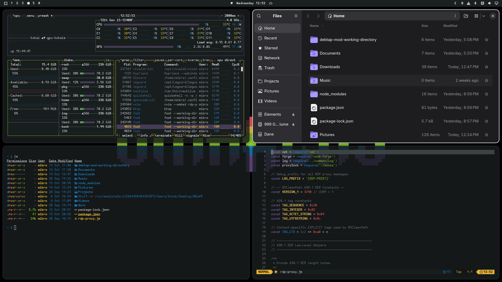

# The Perfect Dark

A dark [Omarchy](https://omarchy.org/) theme built on the **Vibrant Summer** palette —
hot red, citrus yellow, lime green, cool blue and royal purple over near-black `#1b2021`,
with off-white `#f8f9fa` window borders.



## Palette

| Name          | Hex       |
|---------------|-----------|
| Vibrant Coral | `#ff595e` |
| Golden Pollen | `#ffca3a` |
| Yellow Green  | `#8ac926` |
| Steel Blue    | `#1982c4` |
| Dusty Grape   | `#6a4c93` |
| Black         | `#1b2021` |
| Frame         | `#f8f9fa` |

## Install

```bash
omarchy theme install https://github.com/m1k4o/the-perfect-dark
```
